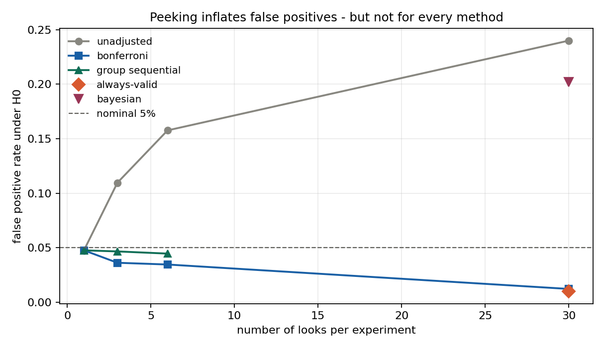
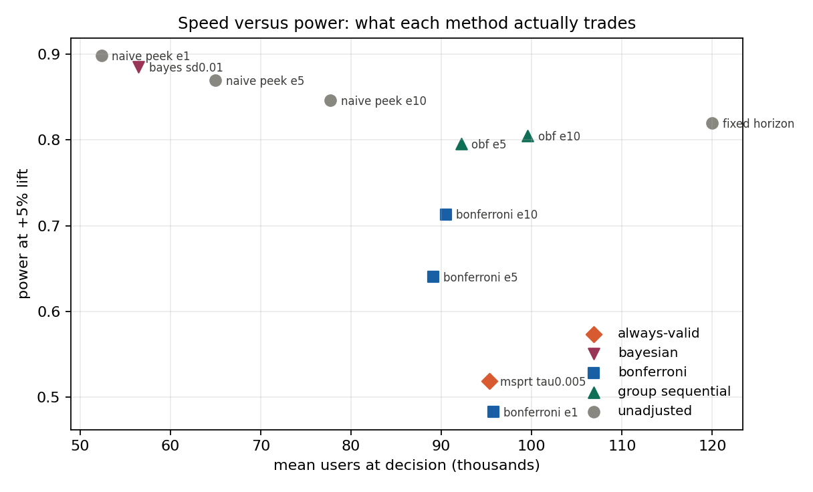

# Study 01 — Sequential testing: five method families compared

**Question.** A dashboard is checked every day. Which stopping method keeps the
false-positive rate at 5%, what does each one cost in power, and what does it
save in users?

**Setup.** 3,000 replications per scenario, 2,000 users/day/arm, 30-day horizon,
baseline conversion 10%, two-sided tests at alpha = 0.05. All policies are
evaluated on identical simulated traffic (common random numbers). Reproduce:

```bash
python -m explabs.sequential.run
python -m explabs.sequential.validate   # 16 correctness checks
```

Methods: fixed horizon, naive peek, Bonferroni, O'Brien-Fleming (Lan-DeMets
alpha spending), mSPRT (Johari et al. 2017), and a Bayesian posterior rule.

---

## Results

### 1. Type-I error under H0 (target 0.05)

| Family | Policy | Looks | FPR |
|---|---|---:|---:|
| unadjusted | fixed horizon | 1 | 4.8% |
| unadjusted | naive peek | 3 | 11.0% |
| unadjusted | naive peek | 6 | 15.8% |
| unadjusted | naive peek | 30 | **24.0%** |
| Bonferroni | every 10 days | 3 | 3.6% |
| Bonferroni | every 5 days | 6 | 3.5% |
| Bonferroni | daily | 30 | 1.2% |
| group sequential | OBF, every 10 days | 3 | 4.7% |
| group sequential | OBF, every 5 days | 6 | 4.5% |
| always-valid | mSPRT, daily | 30 | 1.0% |
| Bayesian | posterior rule, daily | 30 | **20.2%** |



### 2. Power and cost at a true +5% lift

| Policy | Power | Mean day | Mean users | Saved vs fixed |
|---|---:|---:|---:|---:|
| fixed horizon | 82.0% | 30.0 | 120,000 | — |
| **OBF, every 5 days** | **79.6%** | 23.1 | 92,200 | **23%** |
| OBF, every 10 days | 80.5% | 24.9 | 99,573 | 17% |
| Bonferroni, every 5 days | 64.0% | 22.3 | 89,080 | 26% |
| mSPRT, daily | 51.9% | 23.8 | 95,344 | 21% |
| Bayesian, daily | 88.5% | 14.1 | 56,477 | 53% |
| naive peek, daily | 89.8%* | 13.1 | 52,355 | 56%* |

\* Contaminated: that "power" includes the 24% false-positive rate. Shown to
size the leak, not as a contender.



### 3. Sensitivity to the prior scale

| Method | Prior value | FPR | Power |
|---|---:|---:|---:|
| mSPRT | tau = 0.002 | 0.1% | 31.9% |
| mSPRT | tau = 0.005 | 1.1% | 52.3% |
| mSPRT | tau = 0.01 | 1.5% | 50.1% |
| mSPRT | tau = 0.02 | 1.5% | 43.7% |
| Bayesian | sd = 0.005 | 12.7% | 83.4% |
| Bayesian | sd = 0.01 | 19.3% | 86.8% |
| Bayesian | sd = 0.02 | 21.0% | 88.1% |

---

## Four findings

**1. O'Brien-Fleming is the quiet winner on this design.** It is the only
method that holds alpha at every schedule (4.5-4.8% regardless of peeking
frequency) *and* saves sample: 23% fewer users with essentially no power loss
(79.6% vs 82.0%). Bonferroni holds validity but gives up 18 points of power,
because a flat alpha/K is the wrong shape — it is as strict on day 30 as on
day 5.

**2. mSPRT, implemented correctly, is very conservative.** This was checked,
not assumed: the martingale property holds in simulation (E[Lambda] = 1.000 at
day 1 under H0 for every tau tested), and the formula was derived from the
mixture likelihood rather than copied. The measured FPR is 1.0% — not 5%.

The mechanism is visible in closed form. With information `V` and prior scale
`tau`, the implied final-look boundary in z units solves

    exp(tau^2 V z^2 / (2(1 + V tau^2))) / sqrt(1 + V tau^2) = 1/alpha

which, at the optimal `tau`, gives z* = 3.08 at this sample size — equivalent to
a **2.4x sample multiplier** over the fixed-horizon 1.96, and it is impossible
to avoid: no `tau` puts the boundary near 2.0 while keeping power at the
effect of interest. A fixed `tau` cannot be optimal at every information level,
because `V` grows by two orders of magnitude over the experiment. The folklore
"sequential intervals are only slightly wider" describes confidence-sequence
*width* near the target sample size, not mSPRT *power* at a fixed horizon, and
the two statements differ by the square.

**3. Bayesian monitoring does not fix peeking.** Measured FPR: 20.2%, with a
sensible prior (sd = 1pp on a 10% baseline) and a two-sided 95% credible
interval. It behaves like naive peeking with a shrinkage step. "Bayesian is
immune to peeking" is repeated often enough to be worth a measured
contradiction: the posterior is a stopping statistic like any other, and
thresholding it repeatedly does not control the frequentist error rate.

**4. Prior sensitivity cuts both ways.** mSPRT is safe at every prior value
tested (FPR 0.1-1.5%, never approaching 5%) and loses power everywhere — the
Ville bound is valid but loose. The Bayesian rule is never safe (FPR
12.7-21.0%) and looks powerful everywhere, for the same underlying reason:
shrinkage buys stability, not validity.

---

## Validation

`python -m explabs.sequential.validate` runs 16 checks; all pass.

| Check | Result |
|---|---|
| Simulator recovers configured lift | 0.10499 vs 0.10500 (4SE = 0.00011) |
| p-values vs `statsmodels.proportions_ztest` | max abs diff 2.8e-06, correlation 1.000000 |
| K=1 boundary equals fixed-sample 1.96 | 1.9603 |
| Classic OBF K=5 table (4.877...2.031) crosses at alpha | 0.04996 vs 0.05 |
| Pocock mean boundary vs published constant 2.413 | 2.4111 |
| Lan-DeMets per-look spend recovered | max abs diff 1.8e-04 |
| Fixed-horizon FPR at nominal | 0.0460 |
| FPR monotone in number of looks | 1->0.046, 3->0.098, 6->0.151, 30->0.233 |

The OBF cross-check deserves a note: the published boundary vector is pushed
through *our* recursion, so agreement at 0.04996 validates the recursion
against an independently derived construction — not our solver against itself.
The remaining ~4e-4 gap is numerical integration error, documented at ~1e-3 on
the total alpha; nothing in the study depends on that last digit.

Daily OBF looks (K=30) are excluded by design: alpha*(1/30) underflows and the
first boundary runs past z = 8. That is not a bug but the method's own message —
a daily OBF look can never fire, which is why group sequential designs in the
literature use interim analyses, not dashboards.

## References

Full citations in [`REFERENCES.md`](../../REFERENCES.md). The load-bearing
ones: Wald (1945) for the SPRT foundation; Armitage, McPherson & Rowe (1969)
for the recursion; Pocock (1977), O'Brien & Fleming (1979) and Lan & DeMets
(1983) for the boundary family; Johari, Koomen, Pekelis & Walsh (2017) for
mSPRT; Robbins (1970) and Howard et al. (2021) for the always-valid
machinery behind it; Kohavi, Tang & Xu (2020) for the practitioner framing.
