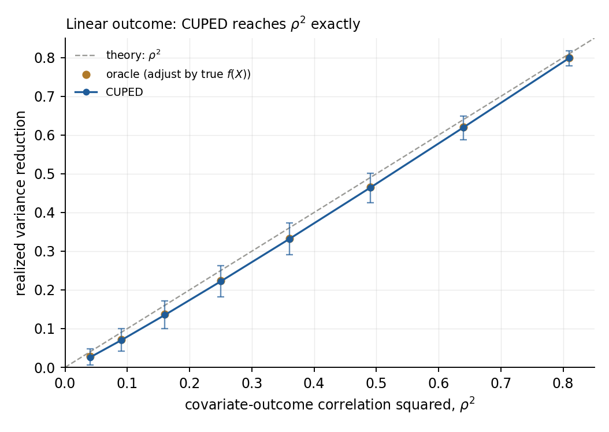
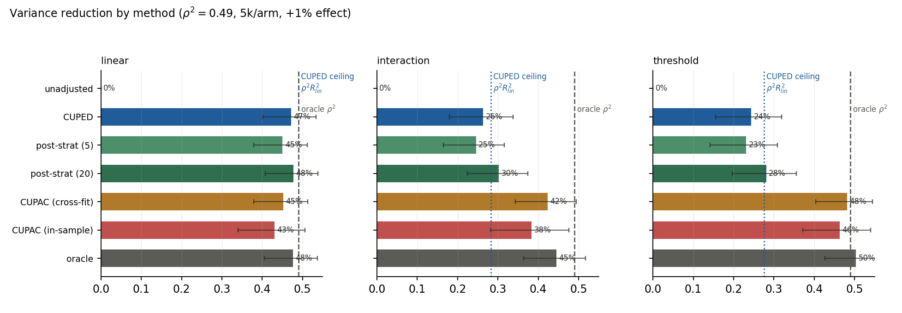
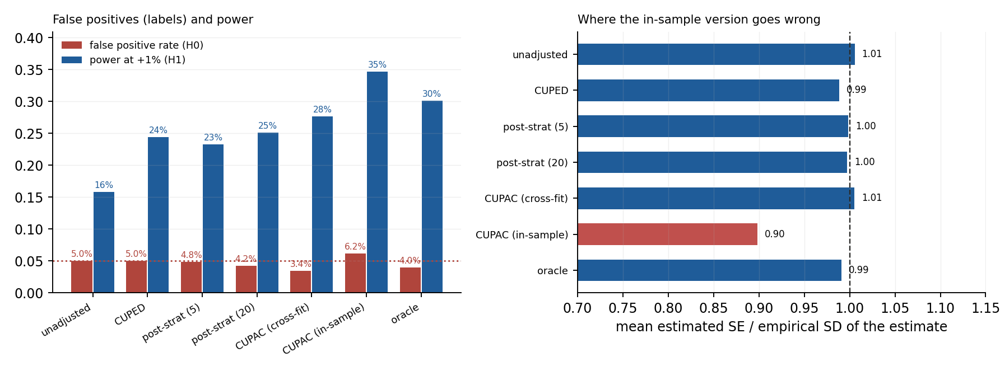

# Study 02 — Variance reduction: CUPED, CUPAC, post-stratification

**Question.** Covariate adjustment is sold as free sensitivity. How much variance
does each method actually remove, when does the linearity assumption cap it, and
what does that buy in MDE and required sample size?

**Answer.** On a linear outcome CUPED removes `rho^2` almost exactly (0.472
measured against 0.490 theory at rho = 0.7) and cuts the required sample by 47%.
On a nonlinear outcome CUPED is capped at `rho^2 * R^2_lin = 0.28`, and a
gradient-boosted covariate (CUPAC) recovers 88% of the remaining gap. Done
*without* cross-fitting, CUPAC understates its own standard error by ~10% —
0.895–0.905 across six independent runs, against a target of 1.000 — and it is
simultaneously *less* efficient than the cross-fitted version, so the mistake
costs on both counts while looking better on the dashboard.

---

## 1. A generator whose ceiling is known

Everything here rests on one property: with a known outcome model, the maximum
achievable variance reduction is a closed-form number, not an opinion.

```
Y = mu + tau * T + signal_sd * f(X) + noise_sd * eps
```

`f` is normalised to mean 0 and variance 1, so with `Var(Y) = signal_sd^2 +
noise_sd^2` and `rho^2 = signal_sd^2 / Var(Y)`:

| quantity | formula | meaning |
|---|---|---|
| variance reduction from adjusting by `f(X)` | `rho^2` | the oracle ceiling |
| variance reduction from adjusting by a *line* in `X` | `rho^2 * R^2_lin` | the CUPED ceiling |
| `R^2_lin` | R^2 of regressing `f` on `X` | how much of the signal is linear |

`X` is 8 covariates from a 2-factor model (max pairwise correlation 0.77), which
is what a pre-period feature set looks like: correlated, redundant, and not
independently informative. Three signal shapes control `R^2_lin`:

| signal | what `f` contains | `rho^2` | `R^2_lin` | CUPED ceiling | oracle ceiling |
|---|---|---|---|---|---|
| `linear` | a linear index | 0.49 | 1.000 | **0.490** | 0.490 |
| `interaction` | linear backbone + interaction + periodic term + hinge | 0.49 | 0.576 | **0.282** | 0.490 |
| `threshold` | step in one covariate + mild smooth terms | 0.49 | 0.563 | **0.276** | 0.490 |

Base case: 5,000 units per arm, metric mean 100, CV 0.5, true effect +1%. The two
nonlinear shapes are not strawmen — the linear backbone is deliberately large, so
CUPED reaches 0.26–0.28 of a possible 0.49 and the gap to close is real but not
absurd.

## 2. Methods compared

| method | adjusts by | coefficient from | note |
|---|---|---|---|
| unadjusted | nothing | — | what the naive dashboard reports |
| CUPED | the covariate vector `X` | regression on **control** units | Deng et al. (2013) |
| CUPAC | a learned prediction `m(X)` | 4-fold cross-fit **within control** | prediction-as-covariate |
| CUPAC (in-sample) | the same prediction | one model, applied in-sample | the mistake, kept as a benchmark |
| post-strat (5 / 20) | quantile bins of a pre-period score | stratum-weighted difference | Miratrix et al. (2013) |
| oracle | the true `f(X)` | regression on control | the ceiling, not a method |

All estimators share one code path — the only difference is which covariate is
handed to the adjustment step (`_cuped_with`), so a comparison cannot be
confounded by a different standard-error formula.

## 3. Result 1 — CUPED reaches `rho^2`, and the ceiling really is `rho^2`



1,500 replications per point, linear outcome, correlation swept from 0.2 to 0.9:

| `rho^2` | 0.04 | 0.09 | 0.16 | 0.25 | 0.36 | 0.49 | 0.64 | 0.81 |
|---|---|---|---|---|---|---|---|---|
| CUPED | 0.026 | 0.070 | 0.135 | 0.222 | 0.331 | 0.464 | 0.620 | 0.799 |
| oracle | 0.028 | 0.072 | 0.137 | 0.224 | 0.333 | 0.465 | 0.621 | 0.800 |
| CUPED / `rho^2` | 0.64 | 0.78 | 0.84 | 0.89 | 0.92 | 0.95 | 0.97 | 0.99 |

The ratio column looks like a systematic failure at low correlation. It is not —
see §7. In absolute terms every point sits within about one variance point of the
line, and the error bars (bootstrap, not a formula) show it.

The oracle tracking CUPED to within 0.002 across the whole range is the useful
part of this figure: on a linear outcome there is nothing for a smarter method to
find, and this is the check that a nonlinear method has to beat to be worth its
complexity.

## 4. Result 2 — nonlinearity is what moves the ceiling, and CUPAC moves it



400 replications per cell, `rho^2 = 0.49`, 5,000 per arm. Bars are variance
reduction with bootstrap 95% intervals; the dotted line is the CUPED ceiling and
the dashed line the oracle.

| method | linear | interaction | threshold |
|---|---|---|---|
| unadjusted | 0.000 | 0.000 | 0.000 |
| post-strat (5 bins) | 0.451 | 0.246 | 0.231 |
| CUPED | **0.472** | 0.263 | 0.244 |
| post-strat (20 bins) | 0.477 | 0.302 | 0.281 |
| CUPAC (in-sample) | 0.430 | 0.384 | 0.463 |
| CUPAC (cross-fit) | 0.453 | **0.423** | **0.482** |
| oracle | 0.476 | 0.445 | 0.504 |

Three things worth reading off this table.

1. **CUPED stops at its ceiling and stays there.** 0.263 against a predicted
   0.282 (interaction), 0.244 against 0.276 (threshold). The ceiling is not a
   metaphor; it is where the line flattens.
2. **CUPAC closes 88% of the gap** on the interaction signal
   (`(0.423-0.263)/(0.445-0.263)`) and **92%** on the threshold signal. It gets
   there with 60 boosted trees on 8 covariates — this is not a case where the ML
   method needs a heroic model.
3. **Post-stratification is the interesting middle.** With 20 bins it beats
   CUPED on both nonlinear shapes (0.302 vs 0.263, 0.281 vs 0.244) without
   fitting anything, because a step function is a better basis than a line when
   the truth has a step. It is also the cheapest method here — no model, no
   fitting, no overfitting risk. If the only covariate you trust is a categorical
   or a coarse score, this is the right tool.

And one warning: on the **linear** signal CUPAC is 1.9 points *worse* than CUPED
(0.453 vs 0.472). That is the correct result — a model's estimation noise is a
cost, and with nothing nonlinear to find it buys nothing. CUPAC is not a strict
upgrade; it is a bet that `f` is nonlinear.

## 5. Result 3 — the in-sample mistake fails on both axes at once



Fitting one model and predicting the same units it was trained on is the single
most common way this goes wrong in production, because it is the shortest code
path. Two independent failures result:

| | CUPAC (cross-fit) | CUPAC (in-sample) |
|---|---|---|
| mean SE / empirical SD | 1.000 – 1.012 | **0.895 – 0.905** |
| type-I error under H0 | 0.028 – 0.040 | 0.052 – 0.068 |
| variance reduction (interaction) | 0.423 | 0.384 |
| coverage | 0.960 – 0.973 | 0.932 – 0.948 |

The in-sample ratio is 0.895 in four of the six runs (three signal shapes × H0
and H1) and 0.905 in the other two — a spread of one point on a quantity that
should be 1.000. That reproducibility is why it is trustworthy and the type-I
column is not: at 400 replications the binomial standard error of a 5% rate is
1.1 points, so the false-positive difference alone is inside noise. The SE ratio
is the sharp diagnostic — a standard error that is 10% too small is a 10% too
large z-statistic, every time, and it does not need many replications to see.

The mechanism: an in-sample prediction absorbs part of the control noise, so the
control mean is pulled toward its own fitted value while the treatment arm's
predictions carry no such shrinkage. The adjustment is tuned for control and
under-tuned for treatment, which is why the *actual* variance goes **up**
(0.384 vs 0.423 is a real efficiency loss) even as the *reported* standard error
goes down. Bad estimate, overconfident interval, better-looking dashboard.

Cross-fitting is not free either: it lands at 0.028–0.040 type-I error and 96.5%
coverage, i.e. slightly conservative. That is the price of averaging fold models,
and it is the right side to err on.

## 6. Decision units: MDE and sample size

Same runs, converted to what a team argues about. MDE is relative, at 80% power
and two-sided 5%, for the base case (5,000 per arm, CV 0.5).

| | relative MDE | required sample | users saved |
|---|---|---|---|
| unadjusted | 2.80% | 1.00× | — |
| CUPED, linear outcome | **2.00%** | 0.53× | **−47%** |
| CUPED, interaction outcome | 2.38% | 0.74× | −26% |
| CUPAC, interaction outcome | 2.08% | 0.58× | −42% |
| CUPAC, threshold outcome | 2.07% | 0.52× | −48% |

The arithmetic is deliberately unglamorous: required sample is proportional to
variance, so a 47% variance reduction is a 47% sample reduction, and MDE moves
with the square root (a 47% variance cut is a 27% MDE cut). No magic, which is
exactly why the numbers are believable.

The practical reading: at `rho = 0.7` a linear adjustment roughly **halves** the
experiment. That is a bigger lever than most sequential-testing methods, and it
costs nothing in validity — which is why CUPED ships in every mature A/B
platform and mSPRT does not.

## 7. A measurement note: why the low-correlation points look bad

The variance reduction is a *difference of two nearly equal variances*. Its
Monte Carlo error is therefore roughly constant in absolute terms — about one
variance point, regardless of the true effect. At `rho^2 = 0.81` that is a 1.2%
relative error; at `rho^2 = 0.04` it is 25%.

This is why §3 reports a ratio column that drifts and a figure that does not, and
why every variance reduction in this study carries a bootstrap interval. It is
also a warning for reading vendor benchmarks: "CUPED gave us 6% variance
reduction" from a small experiment is indistinguishable from "CUPED gave us 1%."

## 8. What this study does not claim

- **No ratio metrics.** CUPED on a rate metric needs a delta-method variance or
  a per-user linearisation step. Not implemented here; the metric is a per-user
  mean with a normal outcome.
- **No heterogeneity.** The true effect is constant. With effect heterogeneity,
  the adjustment coefficient estimated on control is still consistent but the
  interpretation of "variance reduction" changes.
- **CUPAC is one configuration.** 60 iterations, 31 leaves, chosen by measuring
  recovery of `f` (see `estimators.py`); a different model class would move the
  numbers by a few points. The claim is about the *pattern* — learned covariates
  recover nonlinear signal, and require cross-fitting — not about this
  particular model being optimal.
- **The covariate is free.** In practice pre-period data has coverage problems,
  and users without history are a biased subsample. Not modelled.

## 9. Validation

`python -m explabs.variance.validate` runs the check suite; it exits non-zero on
failure. The anchors that matter:

| check | what it proves |
|---|---|
| `ceiling/cuped[linear]`, `ceiling/cuped[interaction]` | measured reduction matches `rho^2 R^2_lin` within a bootstrap interval |
| `ceiling/oracle[*]` | measured reduction matches `rho^2`; the harness is not leaking truth |
| `theory/r2-linear[*]` | `R^2_lin` recomputed on an independent draw agrees with the calibration draw |
| `leakage/cuped`, `leakage/cupac` | permuting treated outcomes changes the estimate by exactly 0 — the coefficient never sees the treated arm |
| `cupac/beats-cuped`, `cupac/below-oracle` | CUPAC closes the gap and does not beat the true signal (paired bootstrap) |
| `cupac/in-sample-understates-se` | the failure being demonstrated actually fails |
| `bias/*`, `coverage/*`, `type-i/*` | every method unbiased, intervals nominal |
| `poststrat/monotone-in-strata` | more bins, more reduction, still under the ceiling |

The leakage check is the one worth explaining: it permutes outcomes *within* the
treated arm, which leaves the treated mean untouched. Any estimator whose
adjustment coefficient is learned on control alone must return an identical
number. It is an exact test — the observed change is 0.00e+00, not "small".

`poststrat` is deliberately excluded from that check: it legitimately uses
treated values within each stratum, so a permutation that moves units across
strata *should* change the answer. Its unbiasedness is covered separately.

## 10. Reproduce

```bash
python -m explabs.variance.run                 # ~13 min on 8 cores (400 reps + 1,500 for the sweep)
python -m explabs.variance.run --quick         # ~2 min smoke run
python -m explabs.variance.validate            # ~5 min, 39 checks
python -m explabs.variance.dgp                 # print the theoretical ceilings
```

Outputs: `results/ceiling_sweep.csv`, `results/method_comparison.csv`, and
`results/raw/*.npz` — the per-replication estimates, so the figures can be
rebuilt without refitting a single model.
