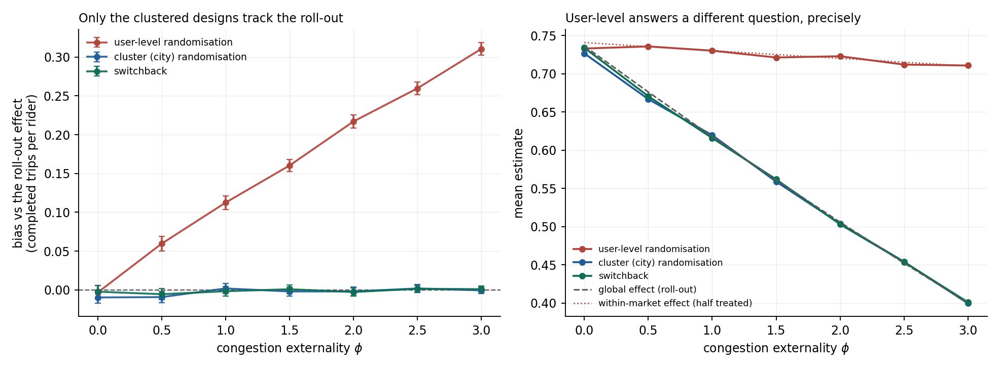
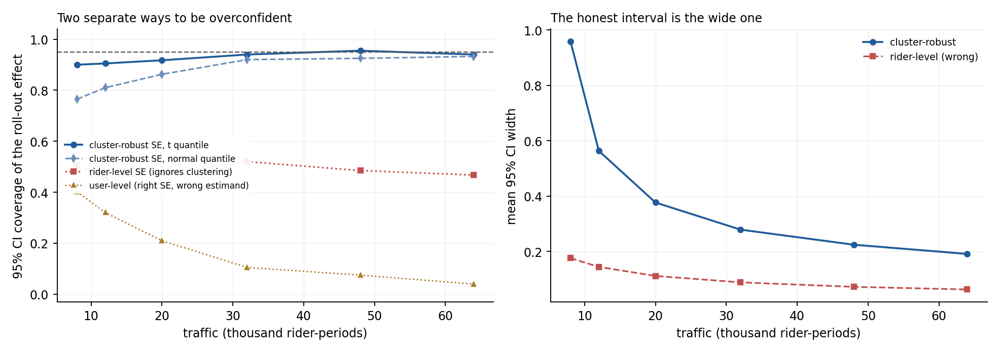
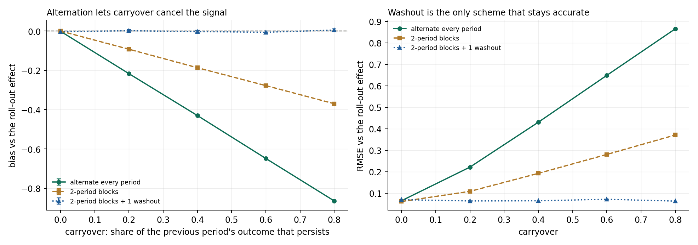
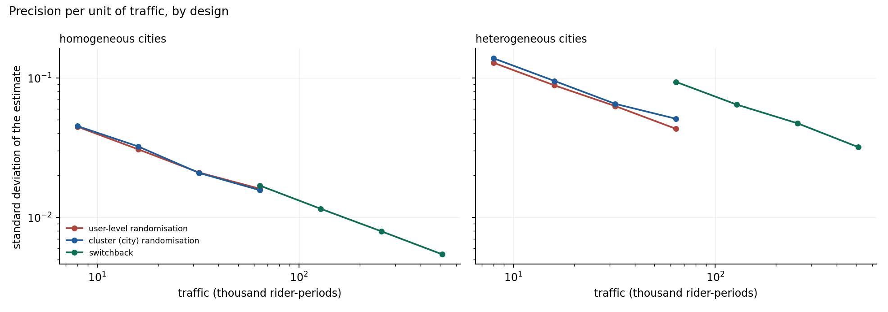
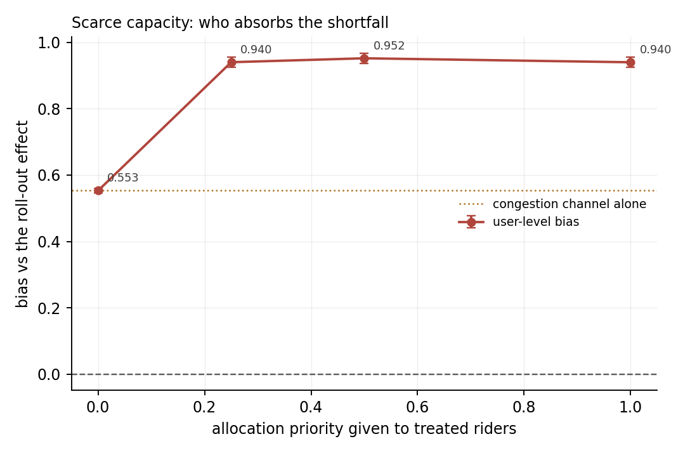

# Study 03 — Interference: user-level vs cluster vs switchback

**Question.** In a two-sided market, a rider-level A/B test answers a question
nobody asked. How large is the gap between what each assignment design measures
and the effect a roll-out would deliver, and what does each design cost in
precision?

**Answer.** User-level randomisation is not a noisy estimate of the roll-out
effect -- it is an *exact* estimate of a different quantity. At the base
calibration it sits 0.731 against a within-market effect of 0.730 (1 MC SE away)
and 0.618 against the roll-out effect (22 SE away). The gap grows with the
externality: 18% of the roll-out effect at the base calibration, 78% when
congestion is strong. Cluster randomisation and switchback both recover the
roll-out effect to within 0.01 everywhere tested. The price is precision, and
where that price lands depends on a parameter teams rarely control: how much
cities differ from each other.

---

## 1. A market where SUTVA is false by construction

One city, one period. Riders make Poisson-distributed ride requests; each
request is completed with a fill probability. Three ingredients, each mapped to
a named parameter:

| ingredient | parameter | what it does |
|---|---|---|
| direct effect | `subsidy`, `demand_elasticity` | treated riders demand 20% more rides |
| congestion externality | `congestion` (phi) | fill probability falls as utilisation rises above baseline; `phi = 0` removes it and restores SUTVA exactly |
| scarcity allocation | `priority` (pi) | when capacity binds, treated riders take a larger share; `pi = 0` is proportional rationing |

Supply responds to total demand with elasticity 0.15, which is what makes the
externality bite: a 20% demand increase moves the driver pool by only 2.8%, so
utilisation rises from 0.80 to 0.93 and everyone's fill rate drops.

Two properties do the analytical work:

- **The roll-out effect is computable.** Solve the market at 100% treated and
  at 0% treated. That difference is the estimand, and it is a number, not an
  argument.
- **The fill rate is multiplicative.** A common congestion shock that hits both
  arms *still* creates an interaction, because treated riders have more rides to
  lose. This is why user-level bias needs no preferential treatment to exist --
  and why it does need capacity to be scarce for `priority` to add anything.

Base case: 2,000 riders, 1,000 drivers (utilisation 0.80), 4 trips per rider,
elasticity 0.8 with a 0.25 city-level SD, subsidy 0.25.

## 2. Three designs, three estimands

| design | randomises | unbiased for | price |
|---|---|---|---|
| user-level | riders within each city | the within-market contrast at the experiment's treated share | not the roll-out effect |
| cluster | whole cities | the roll-out effect | variance grows with the number of *cities* |
| switchback | whole cities over time | the roll-out effect | carryover; fewer cities for the same traffic |

The framing matters and is easy to get backwards in a write-up: calling the
user-level design "biased" is shorthand for "it answers a different question".
Measured against its own estimand it is unbiased to within 1 MC SE. The bias is
a mismatch between question and answer, which is why no standard error can fix
it.

## 3. Results

### 3.1 The gap grows with the externality

Bias against the roll-out effect, 400 replications:

| phi | roll-out effect | user-level | cluster | switchback |
|---|---|---|---|---|
| 0.0 | 0.741 | +0.003 | -0.010 | -0.002 |
| 1.0 | 0.618 | **+0.113 (18%)** | +0.002 | -0.002 |
| 2.0 | 0.514 | **+0.217 (43%)** | -0.002 | -0.003 |
| 3.0 | 0.409 | **+0.311 (78%)** | -0.001 | +0.001 |

With the externality off, all three designs agree. As it strengthens, the
clustered designs stay put and user-level drifts upward without limit -- the
test keeps reporting a benefit that a full roll-out would partly consume in
congestion. This is the "worked in the experiment, disappointing at scale"
pattern, generated by arithmetic rather than by a story about it.



### 3.2 Coverage fails twice, in different ways

Coverage of the roll-out effect as traffic grows:

| traffic (rider-periods) | clusters | cluster SE, t quantile | cluster SE, normal | rider-level SE | user-level |
|---|---|---|---|---|---|
| 8k | 4 | 0.900 | 0.765 | 0.505 | 0.402 |
| 20k | 10 | 0.918 | 0.862 | 0.475 | 0.210 |
| 48k | 24 | 0.955 | 0.925 | 0.485 | 0.075 |
| 64k | 32 | 0.940 | 0.932 | 0.468 | 0.040 |

Two distinct failure modes, both worth naming:

1. **Ignoring clustering** costs coverage outright (~0.47 at every size) and
   never recovers, because the city-level variance component does not shrink
   with rider count.
2. **The normal quantile** under-covers at small cluster counts (0.765 at four
   clusters). A Welch t on cluster means restores most of it (0.900), though
   not all: below roughly ten clusters the honest recommendation is
   randomisation inference, which this repo deliberately does not implement and
   says so rather than implying the t correction is sufficient.

User-level coverage decays toward zero *even though its standard error is
correct* -- it is a well-calibrated interval around the wrong number.



### 3.3 Switchback: carryover has a closed form, and washout is expensive

Modelling carryover as the share `lambda` of the previous period's outcome that
persists (rider habit, driver supply inertia), pure alternation attenuates the
estimate to `(1 - lambda * (2k - 1) / k) * tau` with `k` periods per arm -- the
first period is the only clean one. Measured against predicted, 200
replications, homogeneous cities:

| lambda | predicted | measured (4 SE) |
|---|---|---|
| 0.0 | 0.6243 | 0.6247 (0.0031) |
| 0.2 | 0.4058 | 0.4061 (0.0033) |
| 0.5 | 0.0780 | 0.0776 (0.0033) |
| 0.8 with washout | 0.6243 | 0.6239 (0.0049) |

So "the switchback showed nothing" is not evidence of no effect: at
`lambda = 0.5` a daily-alternation design reports 12% of the true effect. Two
mitigations, both measured:

| scheme | attenuation at lambda = 0.8 | precision at equal traffic |
|---|---|---|
| alternate every period | -0.86 | best |
| 2-period blocks | -0.37 | worse |
| 2-period blocks + 1 washout | ~0 | worst |

Washout removes the bias exactly but pays for it in traffic, which is the trade
teams actually face and rarely quantify.



### 3.4 What precision costs, and where it is spent

Standard deviation of the estimate at 8 cities, two regimes:

| regime | user-level (16k traffic) | cluster (16k) | switchback (128k, normalised to 16k) |
|---|---|---|---|
| homogeneous cities | 0.031 | 0.032 | 0.033 |
| heterogeneous cities | 0.088 | 0.095 | **0.182** |

When cities are interchangeable, all three designs deliver the same precision
per unit of traffic and switchback's extra periods buy nothing *or* cost
nothing. When treatment effects differ across cities -- which they do, with an
elasticity SD of 0.25 here -- switchback's precision is set by its number of
cities, not its traffic, and it lands at nearly twice the standard deviation of
the other two. The periods average away rider noise but cannot average away
city-level effect heterogeneity.

That is the variance-bias frontier in one line: user-level buys precision with
the wrong estimand, cluster buys the right estimand with between-city variance,
switchback buys the right estimand with time -- and time only helps if the
effect is the same everywhere.



### 3.5 The second channel: who absorbs the shortfall

In a strained market (drivers = 830, capacity binds at full treatment), the
congestion channel alone puts user-level bias at +0.55 against a roll-out
effect of 0.14. Adding allocation priority to treated riders raises it to
+0.94 -- the treated arm is shielded from the scarcity its own demand creates,
so the contrast inherits the shield. The roll-out effect itself is
priority-invariant (with everyone treated there is no control arm to crowd out),
so the entire jump is bias.



## 4. What this study does not claim

- The market is a reduced form, not a structural model: no matching queue, no
  spatial dimension, no surge pricing, no driver entry over weeks.
- Carryover is a single reduced-form parameter standing in for several
  mechanisms. The mechanism changes the mapping from `lambda` to bias, not the
  design conclusion.
- The `priority` parameter is a modelling choice. Its role is to separate the
  two bias channels; the congestion channel alone already produces most of the
  bias at the base calibration.
- Randomisation inference for few clusters is the right answer to the
  small-sample coverage gap and is out of scope here.

## 5. Reproduce

```bash
python -m explabs.interference.run --reps 400 --budget-reps 300   # ~2.5 min
python -m explabs.interference.validate                           # 29 checks
```

Outputs land in `figures/` and `results/`. The `--quick` flag runs a smaller
version of everything in under a minute.

## References

Hudgens & Halloran (2008) for the interference vocabulary; Basse & Airoldi
(2018) for why design, not estimation, is where interference is handled; Karrer
et al. (2021) for cluster experiments at platform scale; Bojinov, Simchi-Levi &
Yin (2022) for the switchback formalisation; Kohavi, Tang & Xu (2020) ch. 20
for the marketplace framing. Full citations in [`REFERENCES.md`](../../REFERENCES.md).
