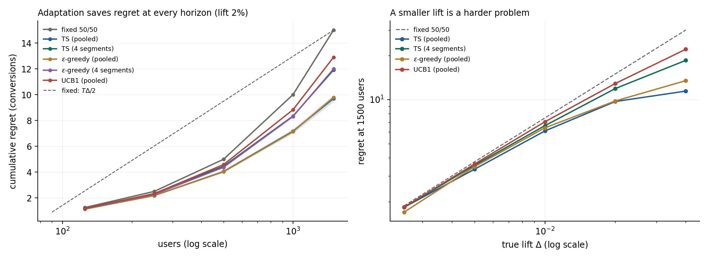
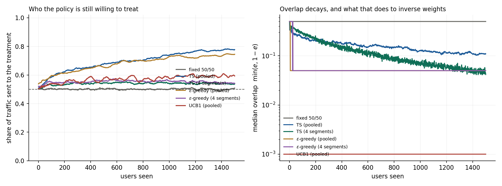
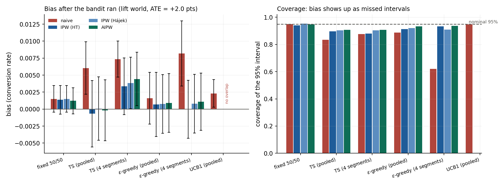
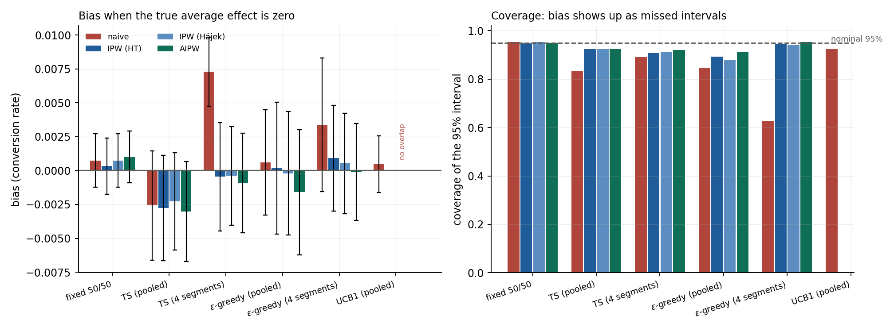
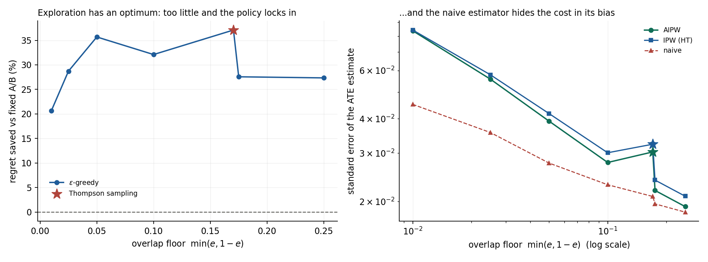

# Study 04 — Adaptive experiments: what a bandit buys, and what it charges

**Question.** Thompson sampling and UCB save traffic compared with a fixed
A/B split. How much, at what effect sizes? And when the experiment is over,
what does it cost to *analyse the data you collected* — the data a bandit gave
you, allocated adaptively?

**Answer.** At a 2-point absolute lift on a 12% base rate, Thompson sampling
returns **35%** of the traffic a fixed split spends on the inferior arm — a
fixed split spends `T·Δ/2` conversions on nothing, and Thompson sampling
recovers 5.3 of those 15 per 1,500 users. The prize grows faster than the gap:
18.6 conversions at a 4-point lift, 0.4 at half a point. The charge is on the
other side of the ledger. The naive difference in arm means after a bandit ran
is biased by **30% of the true effect** and its 95% interval covers **83%** of
the time; after a *contextual* bandit — one that targets by user segment — the
same interval covers **62%**, and when the true effect is zero the naive test
"discovers" one **37%** of the time. Recording the propensity the policy used,
and weighting by it, puts the point estimate back (bias ≈ 0) and the interval
at 89–93%.

The two failure modes are separable, and separating them is the useful part:
*selection bias* comes from a policy that abandons an arm after bad luck;
*composition bias* comes from a policy that sends different kinds of users to
each arm. Pooled Thompson sampling has only the first. Segment-level
Thompson sampling has almost only the second. They are different bugs with
the same fix.

---

## 1. Setup: two worlds, one recorded propensity

Users arrive with two standard-normal features. The control arm converts with
`sigmoid(-2.20 + 0.60·x₁ - 0.40·x₂)` (marginal rate 0.118). Two treatment
worlds:

| world | treatment probability | what it isolates |
|---|---|---|
| **additive** | `p₀(x) + Δ`, Δ ∈ {0.25 … 4 pts} | regret: the per-user effect is constant, so the best fixed policy loses exactly `Δ/2` per user and regret has a closed-form baseline |
| **heterogeneous** | `sigmoid(α₁ + 0.60·x₁ + 0.55·x₂)`, intercept solved for a target ATE | inference: the arms rank users differently, so a targeting policy's allocation correlates with the outcome |

Both arms' probabilities are known in closed form, so *regret* is exact per
user — no plug-in, no simulation of the truth. Segment effects in the
heterogeneous world span −8 to +13 points while their population-weighted sum
is whatever the target ATE says, including exactly zero.

Six policies allocate traffic: fixed 50/50, Thompson sampling (pooled and
per-quadrant), ε-greedy (pooled and per-quadrant), and UCB1. Every policy is
implemented as an explicit Bernoulli draw against its **propensity** — the
probability with which it treats the arriving user given everything it has
seen. Thompson sampling needs that probability every step and it has no closed
form, so it is computed by Gauss–Legendre quadrature on the Beta posteriors
(48 nodes agree with 96 to 2e-8, and with a 400,000-draw Monte Carlo to 2
standard errors). Nothing in the inverse-propensity estimates that follow
rests on an estimated propensity.

Every run records `(assignment, propensity, reward, features)` per user. That
table is the whole study: regret needs the first and third columns, inference
needs all four.

## 2. What adaptation buys

Regret saved against a fixed 50/50 split, 1,500 users, 800 replications:

| true lift Δ | fixed | TS pooled | TS 4-seg | ε-greedy | UCB1 |
|---|---|---|---|---|---|
| 0.25 pts | +0.1% | +2% | +2% | +10% | +2% |
| 0.5 pts | 0.0% | **+11%** | +5% | +7% | +3% |
| 1 pt | +0.1% | **+19%** | +12% | +15% | +6% |
| 2 pts | −0.0% | **+35%** | +21% | +35% | +14% |
| 4 pts | +0.1% | **+62%** | +38% | +55% | +26% |

Monte Carlo standard errors on a percentage point here are 1–3 points (1.1 for
TS at a 4-point lift, 1.9 at a quarter-point one); the quarter-point row is
within one SE of zero, and its seed-to-seed scatter is wider still, because a
minority of replications lock onto the wrong arm and drag the mean.

Three things worth reading off this table:

- **The saving scales with the gap — and faster.** In *conversions* saved per
  1,500 users, Thompson sampling recovers 0.05 / 0.4 / 1.4 / 5.3 / 18.6
  across the grid: where the prize is measurable, halving the gap cuts it by
  roughly 3–4×.
  The percentages flatter the small-gap regime. At a half-point lift the
  entire prize is four-tenths of one conversion — less than the cost of the
  propensity-logging pipeline that §3–§5 show an honest analysis of the
  bandit's data requires. A bandit is not justified by beating the fixed
  split (it always does); it is justified by the gap being large enough that
  the prize covers the machinery.
- **UCB1 cannot separate a small gap.** At 2 points it saves 14% against
  Thompson's 35%. Its exploration bonus is `√(2 log t / n)`, which after 1,500
  users is still ~7× the true gap, so it keeps pulling the inferior arm about
  half the time. Its guarantee is a *bound* — the simulated regret stays under
  14% of `8·log T/Δ` at every horizon tested up to 16,000 users — but the bound
  is never tight in the regime experiments actually run in.
- **Splitting by segment costs regret when effects do not differ.** TS with 4
  segment posteriors saves roughly half of what pooled TS saves at every gap,
  because each segment learns from a quarter of the data. Contextual
  allocation is only worth its variance if the effect actually differs by
  segment.



## 3. What adaptation does to the data

Median overlap floor `min(e, 1−e)` — how surely a user could have landed on
either arm — after 1,500 users:

| policy | overlap floor | steps with floor < 0.05 |
|---|---|---|
| fixed 50/50 | 0.50 | 0% |
| TS pooled | 0.11 | 34% |
| TS 4-segment | 0.04 | 56% |
| ε-greedy (0.1) | 0.05 | 77% |
| UCB1 | 0.00 | 100% |

Thompson sampling decays smoothly toward zero overlap; ε-greedy sits on its
`ε/2` floor by construction; UCB1 has none from step 3 onward, because it is
deterministic. The floor is what inverse-propensity weighting divides by, so
this table is a forecast of what happens in §4.



## 4. Three estimators after the bandit ran

All three target the same estimand — the average treatment effect over the
arrival distribution, ATE = +2.0 points. Horizons 1,500 users, 300
replications. `se` is the mean standard error the estimator reports for
itself; coverage is how often its 95% interval caught the truth.

| policy | estimator | bias | se | coverage |
|---|---|---|---|---|
| fixed 50/50 | naive / IPW / AIPW | +0.0015 | 0.017 | 94–95% |
| TS pooled | naive | **+0.0060** | 0.021 | **83%** |
| TS pooled | IPW (HT) | −0.0007 | 0.034 | 90% |
| TS pooled | AIPW | −0.0002 | 0.032 | 91% |
| TS 4-seg | naive | **+0.0074** | 0.019 | **88%** |
| TS 4-seg | AIPW | +0.0042 | 0.033 | 89% |
| ε-greedy 4-seg | naive | **+0.0082** | 0.019 | **62%** |
| ε-greedy 4-seg | AIPW | +0.0005 | 0.035 | 92% |
| UCB1 | naive | +0.0023 | 0.017 | 95% |
| UCB1 | IPW / AIPW | — | — | **undefined** |

Reading it:

- **The naive estimator is wrong twice.** Its point estimate is biased by
  30–41% of the true effect under every adaptive policy. And its standard
  error is wrong *independently*: under ε-greedy with segments, the mean
  claimed SE is 0.019 while the actual spread of the estimates is 0.041 — the
  interval is half as wide as the phenomenon it claims to describe, which is
  why coverage lands at 62%.
- **IPW repairs the point estimate at a known price.** Horvitz–Thompson with
  the recorded propensities is unbiased everywhere (|bias| ≤ 1.6 MC SE), and
  its SE grows exactly where §3 said it would: 0.041 under pooled TS against
  the naive 0.021.
- **AIPW is the same estimate with slightly less variance.** 4–6% tighter than
  IPW here — modest, and structurally so: with a binary outcome the model
  explains at most a few percent of the outcome variance, so there is little
  for the augmentation to absorb. Its advantage is not efficiency but
  robustness (§5) and stability when propensities are extreme (§7).
- **UCB1 has no inverse-propensity estimate at all.** With propensities of
  exactly 0 and 1 there is nothing to reweight: the estimand is not identified
  from the data the policy produced. The code returns undefined rather than a
  number, and the figure says "no overlap" where the bars would be.
- **Everything undercovers a little under Thompson sampling** — IPW/AIPW
  reach 88–91% against 95% nominal. The bias is gone; what remains is the
  known gap between an influence-function interval computed from one
  adaptive trajectory and the variance of that trajectory, which is what
  Hadad et al. (2021) close with adaptive confidence sequences. Recording
  propensities is necessary; it is not the whole repair.



## 5. Where the naive bias comes from

Decomposing the naive bias on the same runs. **Composition bias** is computed
exactly from the realised share of each segment that the policy sent to
treatment and the true segment rates — it is arithmetic on the allocation, not
an estimate. **Selection bias** is the residual.

| policy | naive bias | composition | selection |
|---|---|---|---|
| fixed 50/50 | +0.0015 | 0.000 | +0.0015 |
| TS pooled | +0.0060 | 0.000 | **+0.0060** |
| TS 4-seg | +0.0074 | **+0.0070** | +0.0004 |
| ε-greedy pooled | +0.0016 | 0.000 | +0.0016 |
| ε-greedy 4-seg | +0.0082 | **+0.0085** | −0.0003 |
| UCB1 | +0.0023 | 0.000 | +0.0023 |

The rows partition cleanly. A pooled policy cannot bias who lands in which
arm, so its entire bias is *selection*: it allocates away from an arm after
bad luck, and the arm's retained sample is its unlucky period. A contextual
policy's bias is almost entirely *composition*: segment 3 (where the treatment
is worth +13 points) receives 87% of its users as treated while segment 2
(where it is worth −8 points) receives 21%, so the treated arm's mean is an
average over a different population than the control arm's. Two mechanisms,
one symptom — and only one of them is what people usually mean by "targeting
confounds your experiment".

## 6. The null world: manufacturing significance

Same heterogeneous world with the treatment intercept solved for **ATE = 0**.
The segment effects still span −10 to +10 points; only their weighted average
is zero. 250 replications, 1,500 users:

| policy | naive coverage | naive rejection at ATE=0 | AIPW rejection |
|---|---|---|---|
| fixed 50/50 | 95% | 4.7% | 4.8% |
| TS pooled | 83% | 16.7% | 7.7% |
| TS 4-seg | 89% | 11.0% | 8.8% |
| ε-greedy 4-seg | **63%** | **37.3%** | **4.8%** |
| UCB1 | 92% | 7.7% | undefined |

A team that ran a contextual bandit on this population, saw "p < 0.05", and
shipped, would ship a null effect roughly three times out of eight. The bias
is only +0.0034 — a third of the nominal SE — which is precisely why it is
dangerous: it is invisible in the point estimate and decisive in the test,
because the naive standard error does not know the allocation was adaptive.



## 7. The exploration dial

ε-greedy is the one policy whose exploration is a single number, so it makes
the trade-off explicit. Additive world, Δ = 2 points, 1,500 users; the
x-axis is the policy's realised overlap floor, and Thompson sampling is placed
on the same axis at its own floor (0.17):

| policy | overlap floor | regret saved | SE (naive) | SE (AIPW) | AIPW coverage |
|---|---|---|---|---|---|
| ε = 0.02 | 0.010 | 20.7% | 0.045 | 0.084 | 87% |
| ε = 0.05 | 0.025 | 28.7% | 0.036 | 0.056 | 91% |
| ε = 0.10 | 0.050 | **35.7%** | 0.028 | 0.039 | 93% |
| ε = 0.20 | 0.100 | 32.1% | 0.023 | 0.028 | 90% |
| ε = 0.35 | 0.175 | 27.6% | 0.020 | 0.022 | 94% |
| ε = 0.50 | 0.250 | 27.4% | 0.018 | 0.019 | 91% |
| Thompson | 0.170 | **37.1%** | 0.021 | 0.030 | 89% |

The frontier is *not* monotone, and that is the finding. Very low ε does not
buy the best regret — with 1% forced exploration the policy commits to
whichever arm looked better in its first handful of users and stays there, so
ε = 0.02 saves less regret than ε = 0.10 while also carrying 2.1× the
standard error. The interesting part of the trade-off is in the middle: around
10–20% exploration you keep most of the regret saving, the AIPW interval is
nearly calibrated, and the estimate costs a little over twice a fixed split's
standard error. Thompson sampling sits at a better point than any ε on the regret axis
and a slightly worse one on the coverage axis.



## 8. Does running the bandit longer fix it?

No — and this is the part that is easiest to get backwards. Naive bias at
1,500–4,000 users:

| users | 500 | 1,000 | 2,000 | 4,000 |
|---|---|---|---|---|
| TS pooled | +0.0034 | +0.0085 | +0.0107 | +0.0092 |
| ε-greedy (0.1) | +0.0154 | +0.0054 | −0.0010 | +0.0025 |

Thompson sampling's bias does not shrink with the horizon; it settles near
half the true effect. Once the policy has abandoned an arm, the arm stops
accumulating data, so its sample mean is frozen at its unlucky period and no
amount of additional traffic revises it. ε-greedy's bias decays like `1/(εT)`:
its floor keeps feeding the abandoned arm fresh, unbiased observations, and
averaging eventually drowns the early selection. Forced exploration is not a
regret concession — it is an identification guarantee.

## 9. What this study does not claim

- The outcome is Bernoulli with two covariates. AIPW's efficiency advantage
  over IPW grows with how much variance an outcome model can remove; with a
  heavy-tailed revenue metric the gap is far larger than the 4–6% here.
- The interval undercoverage under Thompson sampling (88–91% at 95%) is left
  as measured. Closing it needs the adaptive confidence sequences of
  Hadad et al. (2021) or anytime-valid methods, which is its own study.
- Propensities are treated as known when computing influence-function
  variances. That is the conservative choice, and it is available here only
  because the study records exact propensities; a production system that logs
  *estimated* propensities inherits their noise.
- Reward streams are shared across policies (common random numbers), so
  regret comparisons are tighter than independent simulation would give.
  Absolute regret levels inherit whatever bias that induces in neither
  direction — it only reduces comparison variance.

## 10. Reproduce

```bash
python -m explabs.bandits.run --reps 300 --horizon 1500   # ~3 min; the regret sweep always uses >= 800 reps
python -m explabs.bandits.validate                        # 40 checks
```

Outputs land in `figures/` and `results/`. `--quick` runs a smaller version of
everything in under two minutes.

## References

Thompson (1933) for the original sampler; Russo et al. (2018) for the modern
tutorial; Lattimore & Szepesvári (2020) and Auer et al. (2002) for UCB1 and
its bound; Scott (2015) for bandits as business practice; Horvitz & Thompson
(1952) for inverse weighting; Robins, Rotnitzky & Zhao (1994) for augmentation;
Hadad et al. (2021) for why adaptive data breaks standard errors and what
repairs them; Villar, Bowden & Wason (2015) for the selection bias adaptive
trials have known about for a decade; Li et al. (2010) for the propensity-
logging practice this study depends on. Full citations in
[`REFERENCES.md`](../../REFERENCES.md).
