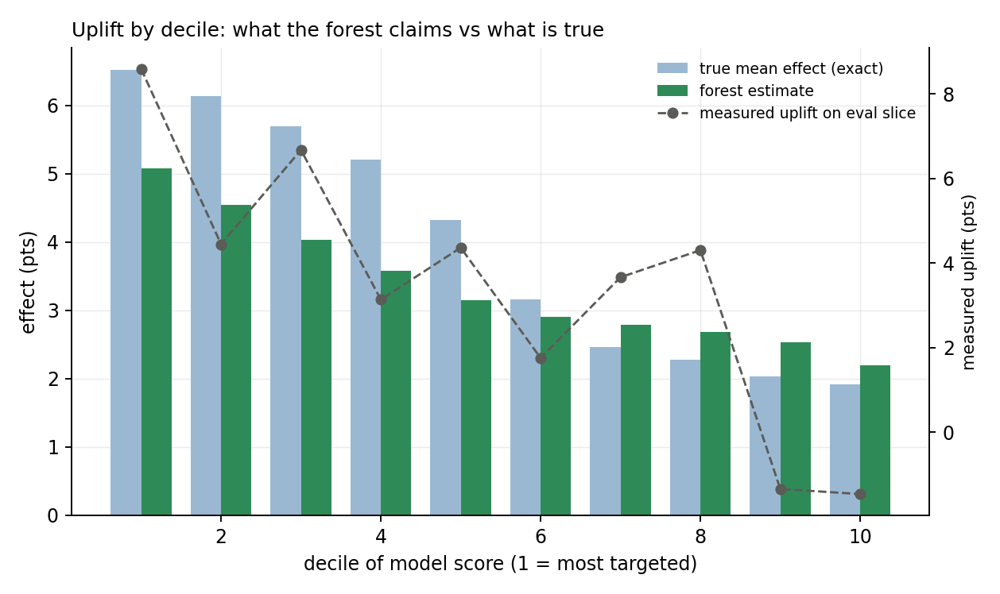

# Study 05 — Uplift modeling: which model turns prediction into targeting?

**Question.** Four models claim to rank users by treatment effect — the
S-learner, T-learner, X-learner and an honest causal forest. Which ranking
actually captures more incremental conversions per user targeted, and can a
held-out Qini evaluation even tell them apart?

**Answer.** On a 100,000-user randomized experiment (85% treated, base rate
16%, effects from −2.5 to +7.5 points), the honest causal forest is the best
model by every measure that resolves anything: effect-recovery correlation
**0.78** against the exact truth (T-learner 0.46, X-learner 0.33, S-learner
0.05), and **89% of the oracle's incremental conversions captured** when
targeting the top 10% of users (T-learner 83%, X-learner 80%, S-learner 76%,
random 55%). Its auQC is statistically indistinguishable from the oracle's
(paired difference −9 ± 36). The uncomfortable part is what *cannot* be
resolved: on the held-out Qini evaluation, no model is separable from any
other model — the only comparison that clears 2 standard errors is every
model against random targeting. At an 85% treated share, the control arm is
the bottleneck, and a Qini test set needs far more users than the point
estimates suggest.

The second uncomfortable part: **model-based differences shrink at the
budget level.** Targeting 10% of the population captures 260 incremental
conversions with the forest against 222 with the S-learner — but the oracle
is 292, and targeting 50% with the *worst* model captures 925 against the
oracle's 1,157. Bad targeting costs less than it looks like it should,
because half the effect is in the plain majority segment that every model
finds.

---

## 1. Setup: one experiment, two slices, one Qini code path

The primary data is a synthetic randomized experiment that doubles as the
ground-truth generator — the same pattern as study 04, and for the same
reason: "uplift by decile against the truth" needs the truth. Features are
ten correlated Gaussians; the response surface is deliberately harder than
the effect surface (interactions and curvature in who converts, a smooth
persuadable gradient plus a backfire segment in how much treatment moves
them); assignment is randomized at 85% treated, Criteo-style. The exact ATE
(+3.97 points) is a one-dimensional quadrature per effect term, checked
against a 400,000-draw Monte Carlo. Loaders for the real Criteo Uplift and
Hillstrom benchmarks are included and unit-tested, so the pipeline accepts
`data/criteo.csv` or `data/hillstrom.csv` unchanged; with no file present it
falls back to the synthetic world.

| Model | Construction | Known weakness |
|---|---|---|
| S-learner | one response surface, treatment as a feature | ignores treatment when the effect is small relative to response noise |
| T-learner | two response surfaces, differenced | inherits both surfaces' errors |
| X-learner | imputes individual effects per arm, then models them, propensity-weighted | more moving parts; the weighting is the whole trick |
| Causal forest | trees split on effect heterogeneity; leaf effects estimated on a *disjoint* sample | without honesty it is a random forest in costume |

One deviation from the roadmap: `CausalForestDML` comes from EconML, which
is not installed here; the forest is implemented by hand instead — Athey &
Imbens' honest recursive partitioning (split on one subsample, estimate leaf
effects on a disjoint one, `n·(τ_L−τ_R)²`-type criterion), averaged over 200
trees. Hand-building it is what makes the honesty comparison in §5 possible.

Every model — and the oracle, and a random ranker — is scored by the *same*
`qini.py` code path (Radcliffe's count-ratio Qini curve). This is one of the
study's validation anchors: Qini implementations differ, and a difference
there leaks straight into the model comparison.

## 2. Effect recovery: estimating the effect vs ranking by it

Against the exact per-user effect on the 40,000-user evaluation slice:

| model | RMSE | correlation | mean τ̂ (truth 0.0397) |
|---|---|---|---|
| S-learner | 0.0366 | 0.054 | 0.0098 |
| T-learner | 0.0370 | 0.458 | 0.0339 |
| X-learner | 0.0307 | 0.328 | 0.0340 |
| causal forest | **0.0165** | **0.777** | 0.0335 |

Reading it:

- **The S-learner barely plays.** Its correlation with the truth is 0.05 and
  its average effect estimate is a quarter of the truth: the treatment
  column is one feature among ten, no split in the response surface uses it,
  and the model concludes "no effect anywhere". In the constant-effect
  validation world it collapses to exactly 0.0000 — the failure mode
  Künzel et al. predicted, and the reason S-learners should be a baseline,
  not a candidate.
- **RMSE and ranking need not agree.** The T-learner has a better
  correlation than the X-learner (0.46 vs 0.33) but a worse RMSE (0.037 vs
  0.031): the X-learner is smoother, the T-learner noisier but better
  calibrated in the tails where ranking is decided. Their capture rates
  (§5) sit 1–2% apart, in the T-learner's favour at 10% targeting and the
  X-learner's at none of them — a reminder that "better effect estimates"
  and "better targeting" are related but distinct claims.

## 3. The Qini evaluation and its power problem

auQC (area between the Qini curve and the random-ranking diagonal;
incremental responses over the 40,000-user evaluation slice; paired
bootstrap SE over evaluation users):

| model | auQC | SE |
|---|---|---|
| random | −57.5 | 49.3 |
| S-learner | 164.5 | 58.5 |
| T-learner | 213.4 | 59.1 |
| X-learner | 235.7 | 56.8 |
| oracle | 244.4 | 53.3 |
| causal forest | 253.4 | 53.7 |

Paired differences: forest − random **+313 ± 71**; forest − S +89 ± 75;
forest − T +37 ± 58; forest − X +17 ± 58; oracle − forest **−9 ± 36**.

- **The forest is indistinguishable from the oracle on this test set.** That
  is the best sentence in the table and it is honest: with 85% treated, only
  ~6,000 of the 40,000 evaluation users are controls, and each control
  contributes scaled noise to the cumulative curve. The ordering of the
  models matches the exact-truth ordering everywhere, but every model-vs-
  model gap is inside 1.5 SE.
- **Power is checkable, not assumed.** The validation suite runs the same
  comparison in a balanced-arm world (50% treated, 30k evaluation users):
  there the oracle separates from random by +115 ± 27 and random from an
  anti-oracle (deliberately inverted ranking) by +83 ± 29. The machinery is
  fine; the 85%-treated evaluation slice is simply an expensive place to
  distinguish good models from each other.
- **Practical translation:** if your treated share is 85%, your Qini test
  set needs several times more users than your training set — or a balanced
  holdout — before "our new model beats the incumbent" is a measurement
  rather than a hope. auQC differences of 20–90 points here would be
  reported as wins in a typical writeup.

## 4. Uplift by decile



The forest's estimates track the true decile profile in shape, with two
honest imperfections. First, **shrinkage**: the top decile's true mean
effect is 6.5 points and the forest says 5.1 — averaging over 200 trees
pulls extremes in, which is the price of the forest's low variance.
Second, the *measured* uplift on the evaluation slice (dashed) is noisier
than either bar series in the middle deciles, even though it is unbiased:
with ~600 controls per decile, a decile-level difference-in-means has a
standard error around 1.6 points, comparable to the decile-to-decile
variation it is trying to detect.

## 5. What the constructions promise, checked

Each model's headline claim, machine-checked in `explabs/uplift/validate.py`:

- **Anchor 1 — constant effects, agreeing curves.** In a world where every
  individual effect is exactly 2.0 points, all four models' auQC values sit
  within the random-ranker noise band (spread < 5 SE) and the T/X/forest
  mean effect estimates are within 0.008 of the truth. The S-learner's
  collapse to 0.0000 is recorded as its own check, not averaged away.
- **Anchor 2 — one strong segment.** With the effect equal to 10 points on
  21% of users and zero elsewhere, every model's top decile by score has a
  true mean effect of 8.4–10.0 points (population mean: 2.1). The oracle's
  top decile is exactly the segment.
- **The X-learner's imbalance claim.** At a 10% treated share the X-learner
  beats the T-learner on both RMSE (0.048 vs 0.063) and correlation (0.48 vs
  0.35) — Künzel's propensity weighting doing exactly what it was designed
  to do. Note the mirror image of §2: the X-learner wins when *treatment* is
  scarce; at 85% treated the T-learner edges it.
- **Honesty is not decoration.** The same forest with `honest=False` (leaf
  effects estimated in-sample) has a fresh-data RMSE of 0.0262 against the
  honest forest's 0.0200. The costume version overfits its leaves; that is
  the entire difference between a causal forest and a random forest with
  extra steps.
- **One Qini code path.** The curve formula is checked against a
  hand-computed example, the random ranker is a measured null, and the
  oracle / anti-oracle ordering passes at 2 paired SE in a balanced world.

## 6. Budget allocation: the decision the model is actually for

Incremental conversions captured by targeting the top-f users (exact truth,
60,000-user training set, 40,000-user evaluation population):

| targeted | random | S | T | X | forest | oracle |
|---|---|---|---|---|---|---|
| 5% | 80 | 108 | 121 | 118 | **133** | 148 |
| 10% | 160 | 222 | 243 | 235 | **261** | 292 |
| 20% | 320 | 391 | 473 | 457 | **506** | 560 |
| 50% | 795 | 925 | 987 | 937 | **1115** | 1157 |
| 100% | 1590 | 1590 | 1590 | 1590 | 1590 | 1590 |

As shares of the oracle: the forest captures 89% at 10% targeting and 96% at
50%; the S-learner 76% and 80%. Two readings:

- **The forest's edge is worth having and easy to overstate.** At a 10%
  budget it converts 89% of the theoretically available lift; the
  second-best model converts 83%. The 6-point gap is real (it replicates
  across training draws in validation) but it is a difference between two
  good decisions, not between good and bad.
- **Targeting 50% with any model captures most of the effect.** The
  persuadable gradient is smooth, so even a mediocre ranking puts
  above-average users near the top. The scenario where model choice matters
  most is a *small* budget against a *concentrated* effect — which is why
  the single-segment validation world matters: there, ranking the top decile
  correctly is the whole game, and every model passes it.

## 7. What this study does not claim

- The headline numbers are one synthetic world with one training draw per
  model. The auQC ordering is stable across validation worlds, but a single
  draw's capture gap (e.g. forest 261 vs T 243 at 10%) carries training
  noise the paired bootstrap on the evaluation slice does not cover. The
  cross-draw checks (§5) are the replication evidence.
- The honest forest here is a direct implementation of Athey–Imbens
  splitting with honest leaf estimation, not EconML's `CausalForestDML`
  (no centered forest, no subsample-based doubly robust calibration). Its
  calibration is validated (mean τ̂ across three draws: 0.0425 vs ATE
  0.0397), but larger forests with calibrated subsampling would do better
  still.
- The X-learner is implemented with the true (randomized) propensity. On
  observational data its imputations inherit the response models' bias, and
  the weighting trick does not repair confounding — study 04's machinery
  would be needed first.
- Qini is computed on randomized holdout data only. The common practice of
  evaluating uplift models on the same non-randomized data used for training
  is not reproduced or endorsed here.

## 8. Reproduce

```bash
python -m explabs.uplift.run        # ~3.5 min, synthetic 100k users
python -m explabs.uplift.validate   # 24 checks, ~4.5 min
```

To run against a real benchmark, drop a Criteo-shaped CSV (`f0..f11`,
`treatment`, `visit`/`conversion`) or a Hillstrom-shaped CSV (`segment`,
`visit`/`conversion`/`spend`) into `data/` and re-run. Outputs land in
`figures/` and `results/`; ground-truth-dependent outputs (decile truth,
capture) are skipped automatically for real data.

## References

Künzel, Sekhon, Bickel & Yu (2019) for the T/S/X-learner constructions and
the propensity weighting; Athey & Imbens (2016) for honest causal trees;
Wager & Athey (2018) and Athey & Wager (2019) for causal forests; Radcliffe
(2007) and Radcliffe & Surry (2011) for Qini and uplift reporting
conventions; Diemert et al. (2018) for the Criteo benchmark. Full citations
in [`REFERENCES.md`](../../REFERENCES.md).
